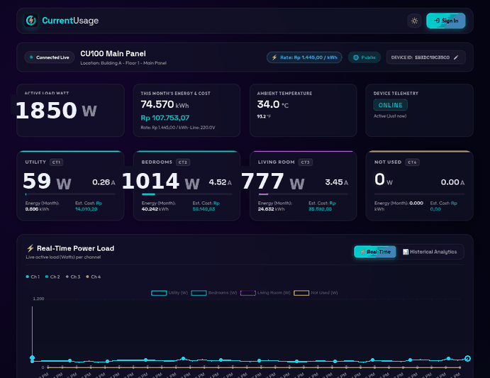
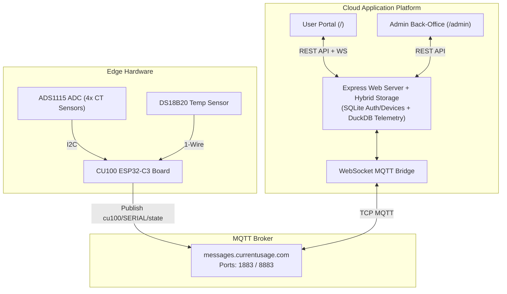

# CU100 Smart Energy Monitor & Cloud Platform

[](https://www.espressif.com/en/products/socs/esp32-c3)
[](https://github.com/espressif/esp-idf)
[](./cloud-dashboard)
[](https://github.com/guritnom/cu/actions/workflows/secret-scan.yml)
[](./LICENSE.md)

The **CU100** is an open-source, multi-channel smart energy monitoring system. It combines an **ESP32-C3 edge device** (sampling 4 CT current channels and ambient temperature) with a **real-time cloud web platform** featuring user device management, privacy settings, and a dedicated admin back-office.



---

## 🏗 System Architecture



---

## ✨ Features

### 📡 ESP32-C3 Firmware (`cu100/`)
- **4x CT Current Sensors**: High-precision current & power sampling via ADS1115 16-bit ADC.
- **Temperature Sensor**: Ambient temperature monitoring via DS18B20 1-Wire protocol.
- **MQTT Telemetry**: Automatic publishing to topic `cu100/<SERIAL_NUMBER>/state` with Last Will and Testament (LWT) support on `cu100/<SERIAL_NUMBER>/status`.
- **Local Web Portal**: Built-in HTTP server for local WiFi configuration & CT sensor calibration.

### 🌐 Cloud Web Application (`cloud-dashboard/`)
- **Real-Time Glassmorphic UI**: Dynamic telemetry gauges and live power load line graphs powered by Chart.js.
- **User Portal (`/`)**:
  - Self-registration & JWT login.
  - Multi-device switcher dropdown.
  - Device management (Claim device by ID/Serial, custom name, and physical location).
  - **Dashboard Privacy Controls**: Toggle device visibility between **Public 🌐** (accessible via `?device=...`) and **Private 🔒** (restricted to owner/admin).
  - **Device QR Code & Printable Labels 🏷️**:
    - Generates scannable QR codes and hardware labels containing the direct URL (`https://dashboard.currentusage.com/?device=<device_id>`) and device ID.
    - Interactive label modal with 3 layout styles: *Hardware Sticker* (enclosure-ready), *Asset Tag* (detailed specs), and *QR Only*.
    - High-res PNG & SVG vector download, direct URL copy, and single label print.
    - **Batch Sheet Printing**: Print all registered device labels at once on sticker paper or sheets.
  - **Real-Time ⚡ vs Historical Analytics 📊 View Switcher**:
    - **Real-Time Mode**: Subscribes to live WebSocket telemetry stream and updates interactive gauges & power load graphs.
    - **Historical Mode**: Queries **DuckDB** time-series data with time-range filtering (`1h`, `24h`, `7d`, `30d`) and downsampling resolutions (`1m`, `5m`, `1h`, `1d` rollups).
- **Hybrid Storage Architecture (SQLite + DuckDB)**:
  - **SQLite (`cu100_cloud.db`)**: Manages user profiles, passwords (`bcryptjs`), JWT tokens, roles, device metadata, retention settings, and privacy authorization.
  - **DuckDB (`cu100_telemetry.duckdb`)**: Embedded columnar database engine handling high-frequency sensor telemetry (`v_rms`, `i_rms1..4`, `p_active`, `temp`) with asynchronous memory batch buffering and fast analytical aggregations.
- **Admin Back-Office Portal (`/admin`)**:
  - Dedicated back-office portal accessible at `/admin`.
  - **User Account Management**: Full CRUD operations for provisioning accounts and assigning system roles (`admin` or `user`).
  - **Global Device Audit**: View all claimed devices across all users, edit locations, and reassign ownership.
  - **Automated Telemetry Retention Control ⏱️**:
    - Admin-managed per-user retention policy (**7 Days [Default]**, **1 Month / 30 Days**, and **6 Months / 180 Days**) persistent per user in SQLite (`users.retention_period`).
    - Daily in-process background scheduler purges expired DuckDB telemetry records per device based on each owner's assigned cutoff policy.
  - **Admin Audit Log**: All privileged actions (create/update/delete user or device) are recorded with admin username, target, and IP address. Viewable via `GET /api/admin/audit-log`.
  - System stats overview (Total Users, Total Devices, Public/Private counts).

### ⚡ Project Landing Page
- A dedicated, high-performance web landing page showcasing the CU100 hardware
  and CurrentUsage cloud lives on [currentusage.com](https://currentusage.com)
  (marketing site — kept outside this repository).

---

## 🚀 Quick Start Guide

### 1. ESP32-C3 Firmware Setup

#### Prerequisites
- Install [ESP-IDF v5.0+](https://docs.espressif.com/projects/esp-idf/en/latest/esp32c3/get-started/index.html).

#### Build & Flash
```bash
# Navigate to firmware directory
cd cu100

# Configure target for ESP32-C3 (first-time only)
idf.py set-target esp32c3

# Build firmware (or run ./idf.sh build)
idf.py build

# Flash to board & monitor serial output
idf.py -p /dev/ttyUSB0 flash monitor
```

---

### 2. Cloud Web Application Setup

#### Prerequisites
- [Node.js](https://nodejs.org/) (v18 or higher) & `npm`.

#### Installation & Launch
```bash
# Navigate to cloud dashboard directory
cd cloud-dashboard

# Install backend dependencies
npm install

# Start server
npm start
```

The server will start on port **3000**:
- **Landing Page**: `http://localhost:3000/landing`
- **User Portal**: `http://localhost:3000/?device=a4cf1289b0c4`
- **Admin Back-Office Portal**: `http://localhost:3000/admin`

#### Environment Variables

> [!IMPORTANT]
> `JWT_SECRET` is **required**. The server will **refuse to start** if it is not set. Generate a strong secret before running in any environment.

```bash
# --- REQUIRED ---
export JWT_SECRET=$(openssl rand -hex 32)   # Strong random secret — generate once, save securely

# --- OPTIONAL ---
export PORT=3000
export APP_URL=https://dashboard.currentusage.com  # Base public URL for QR codes / labels (defaults to request host)
export MQTT_HOST=messages.currentusage.com
export MQTT_PORT=1883
export MQTT_USER=admin_bridge_user
export MQTT_PASS=admin_bridge_password

# --- OPTIONAL: Admin account initial password (used only on first run if no admin exists) ---
# If not set, a random password is generated and printed ONCE to stdout at startup.
export ADMIN_INIT_PASSWORD=your_secure_admin_password
```

For persistent deployments, store these in a `.env` file (never commit it to version control) and load with a process manager like `pm2` or `systemd`:

```bash
# .env (add to .gitignore)
JWT_SECRET=your_generated_secret_here
ADMIN_INIT_PASSWORD=your_secure_admin_password
```

#### Mosquitto Broker Authentication Setup (`mosquitto-go-auth`)
Configure Mosquitto to authenticate physical devices against the Node.js server via HTTP POST by editing `/etc/mosquitto/mosquitto.conf`:

```ini
per_listener_settings false
allow_anonymous false

# Standard TCP Listener for ESP32 Edge Devices & Local Server Bridge
listener 1883 0.0.0.0
protocol mqtt

# HTTP Authentication Plugin (mosquitto-go-auth)
auth_plugin /etc/mosquitto/go-auth.so
auth_opt_backends http
auth_opt_has_sentinel true

# Built-in In-Memory Caching (Reduces DB queries by 99%)
auth_opt_cache true
auth_opt_cache_type memory
auth_opt_cache_reset true
auth_opt_auth_cache_seconds 300
auth_opt_acl_cache_seconds 300

auth_opt_http_host 127.0.0.1
auth_opt_http_port 3000
auth_opt_http_getuser_uri /api/mosquitto/user
auth_opt_http_superuser_uri /api/mosquitto/superuser
auth_opt_http_aclcheck_uri /api/mosquitto/acl

auth_opt_http_method POST
auth_opt_http_response_mode status
```

#### First-Run: Admin Account Setup

> [!IMPORTANT]
> There is **no default admin password**. On the very first start, if no admin account exists in the database:
> - If `ADMIN_INIT_PASSWORD` is set in the environment, that password is used.
> - If it is **not** set, a **cryptographically random password is generated and printed once** to the server console. **Save it immediately** — it will not be shown again.

```
⚠️  [DB SECURITY] No ADMIN_INIT_PASSWORD env var set.
⚠️  [DB SECURITY] Generated one-time admin password: "adm_3f8a1c..."
⚠️  [DB SECURITY] SAVE THIS NOW — it will not be shown again.
```

The admin username is always `admin`. After first login, change the password via the Admin Back-Office user management panel.

> [!CAUTION]
> The old default `admin` / `admin123` credentials **no longer exist**. Any existing database created before this security update that still uses `admin123` should have its admin password changed immediately via the back-office.

---

## 📁 Repository Structure

```
currentusage/
├── cu100/                      # ESP32-C3 Edge Firmware
│   ├── CMakeLists.txt          # ESP-IDF CMake build configuration
│   ├── sdkconfig.defaults      # ESP-IDF default SDK configuration
│   ├── idf.sh                  # ESP-IDF build & flash helper script
│   ├── home_assistant_rest.yaml# Home Assistant REST sensor integration
│   ├── main/                   # ESP32-C3 Firmware Source Code
│   │   ├── main.c              # Application entry point
│   │   ├── ads1115.c           # ADS1115 I2C ADC driver
│   │   ├── ds18b20_manager.c   # DS18B20 1-Wire temperature driver
│   │   ├── mqtt_manager.c      # MQTT telemetry client & LWT
│   │   ├── wifi_manager.c      # WiFi connection manager
│   │   └── web_server.c        # Local captive portal & web server
│   └── managed_components/     # ESP-IDF managed dependencies
├── cloud-dashboard/            # Cloud Web Application Platform
│   ├── server.js               # Express server, REST APIs & WS MQTT Bridge
│   ├── db.js                   # SQLite database engine (Users, Roles & Device metadata)
│   ├── telemetry_db.js         # DuckDB database engine (Time-series telemetry & aggregations)
│   ├── index.html              # User Portal frontend UI & view mode switcher
│   ├── app.js                  # User Portal logic, MQTT WebSocket handler & DuckDB API client
│   ├── admin.html              # Dedicated Admin Back-Office frontend UI
│   ├── admin.js                # Admin Back-Office application logic
│   ├── style.css               # Modern Glassmorphism CSS stylesheet
│   ├── POSTMAN_DOCUMENTATION.md# Postman API documentation
│   └── cu100_postman_collection.json # Postman collection
├── mosquitto.conf              # Mosquitto MQTT broker configuration
└── LICENSE.md                  # Multi-license overview (AGPL-3.0 / Apache-2.0)
```

---

## 🏷️ Device QR Codes & Physical Labels

Each registered CU100 device can have a physical hardware sticker or label generated containing the device ID and direct dashboard URL: `https://dashboard.currentusage.com/?device=<device_id>` (e.g. `https://dashboard.currentusage.com/?device=e83dc19c35c0`).

### 1. Web Portal Interface
- **User Portal (`/`)**: Under **My Registered Devices**, click **🏷️ Label** on any device to open the preview modal, switch between layout styles (*Hardware Sticker*, *Asset Tag*, *QR Only*), download high-res PNG or SVG, or click **🖨️ Print Label**.
- **Batch Printing**: Click **🖨️ Print All QR Labels** above the devices table in either User Portal or Admin Back-Office (`/admin`) to preview and print a ready-to-cut sheet of all registered devices.

### 2. REST API Endpoints
- `GET /api/devices/:deviceId/qrcode`: Generates QR code. Supports parameters:
  - `format=png` (binary image) or `format=svg` (vector) or `format=json` (default, includes base64 `dataUrl`, `svg`, metadata)
  - `size=<px>` (default 320, max 1024)
  - `download=1` (prompts file download attachment)
- `GET /api/devices-qrcodes`: Returns batch QR codes and metadata for all devices owned by the authenticated user (or all system devices if admin).

### 3. Offline / Batch CLI Generator
Generate PNGs, SVGs, and a standalone `print_labels.html` sheet directly from the terminal for manufacturing or workshop sticker printing:
```bash
cd cloud-dashboard
npm run labels
# Or: node generate_labels.js
```
Output files will be saved in `cloud-dashboard/labels/`.

---

## 🔒 Security & Privacy

This project follows security best practices, hardened after a full security audit. Below is a summary of the protections in place.

### Authentication
| Protection | Detail |
|---|---|
| **JWT Authentication** | JSON Web Tokens with 7-day expiration. Token is stored in an **HttpOnly, SameSite=Strict cookie** — never accessible to JavaScript, mitigating XSS token theft. |
| **Required JWT Secret** | `JWT_SECRET` **must** be set via environment variable. The server crashes at startup if it is missing — no insecure fallback. |
| **Password Hashing** | All user passwords stored with `bcryptjs` (10 salt rounds). |
| **MQTT Password Hashing** | IoT device MQTT credentials stored as bcrypt hashes. Auth webhooks use `bcrypt.compare()`. Plaintext password is only returned once (at creation/regeneration) and is never retrievable afterwards. |
| **Login Rate Limiting** | Login endpoint is capped at **20 requests per 15 minutes** per IP to prevent brute-force attacks. |
| **reCAPTCHA v2 Protection** | Configurable Google reCAPTCHA v2 on User and Admin login forms (`RECAPTCHA_SITE_KEY` & `RECAPTCHA_SECRET_KEY`). Gracefully bypassed in development if keys are absent. |
| **Secure Logout** | `POST /api/auth/logout` clears the session cookie server-side. |

### Data Access & Privacy
| Protection | Detail |
|---|---|
| **Private Device Enforcement** | WebSocket MQTT bridge validates device ownership before streaming telemetry for private devices. Unauthenticated clients cannot receive private data. |
| **WebSocket Publish Gate** | Only authenticated users can publish to MQTT topics via the WebSocket bridge. Users can only publish to topics for devices they own. |
| **Admin-Only Routes** | All `/api/admin/*` endpoints require `role: 'admin'` — enforced server-side via middleware. |
| **Telemetry Privacy Check** | Historical telemetry endpoint (`/api/telemetry/history`) enforces the same private device ownership rules. |

### Infrastructure
| Protection | Detail |
|---|---|
| **Static File Blocklist** | Backend source files (`server.js`, `db.js`, `telemetry_db.js`), database files (`.db`, `.duckdb`, `.duckdb.wal`), and `package.json` are blocked from direct HTTP access. |
| **SQL Injection Prevention** | All SQLite queries use parameterized statements. DuckDB `DELETE` operations use parameterized queries or strictly validated alphanumeric device IDs. |
| **Admin Audit Log** | Every privileged admin action (create/update/delete user or device) is recorded in the `admin_audit_log` table with admin ID, target, details, and IP address. Viewable at `GET /api/admin/audit-log`. |

---

## 📄 License

Multi-license, per component:

| Component | License |
|---|---|
| Cloud dashboard (`cloud-dashboard/`) | [AGPL-3.0](./cloud-dashboard/LICENSE) |
| Device firmware (`cu100/`) | [Apache-2.0](./cu100/LICENSE) |
| Documentation | CC-BY-SA 4.0 |

See [LICENSE.md](./LICENSE.md) for the full overview and plain-language
summary.
